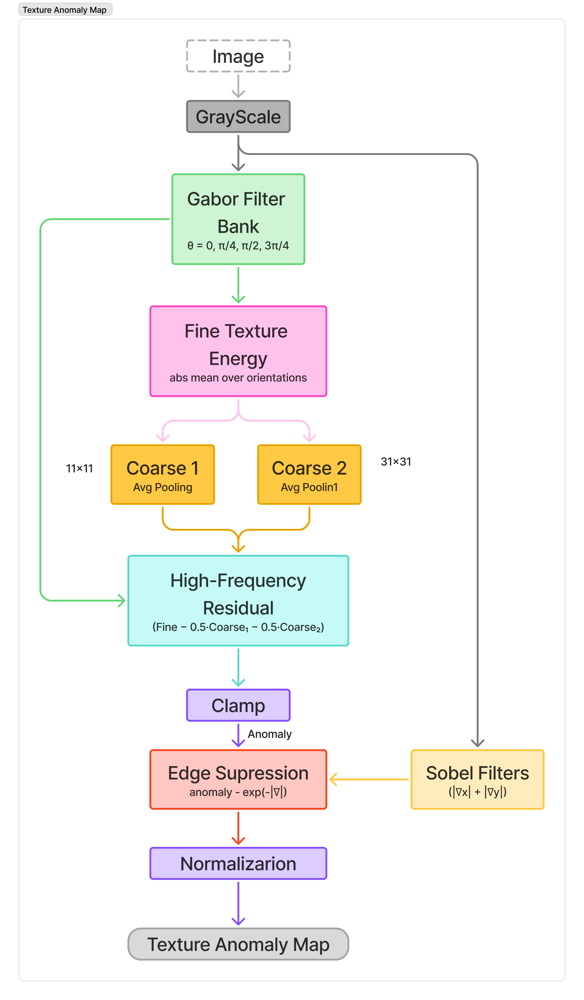
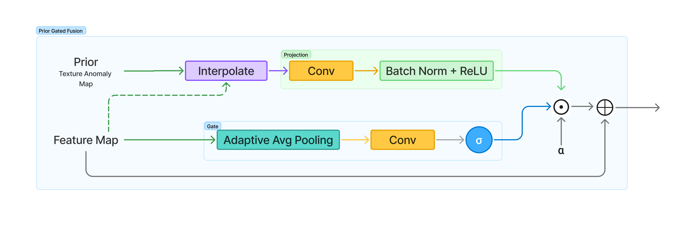
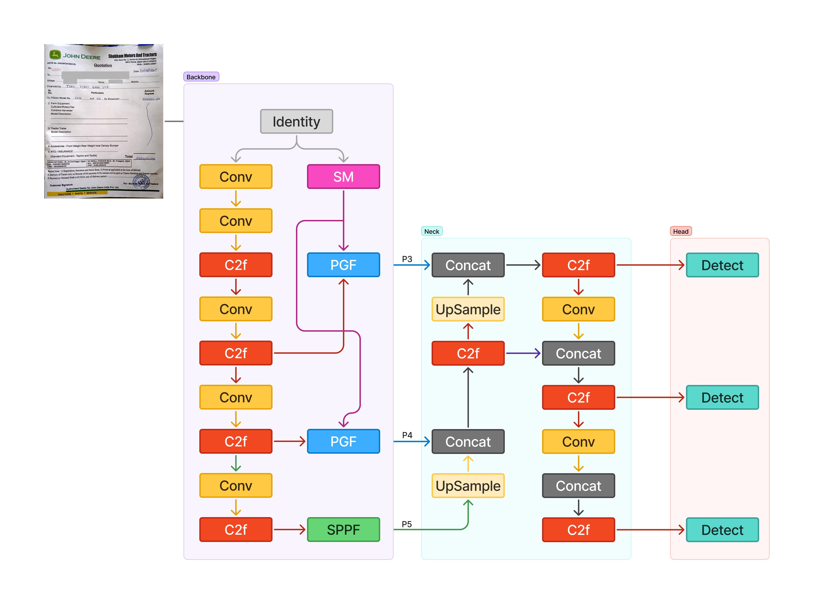
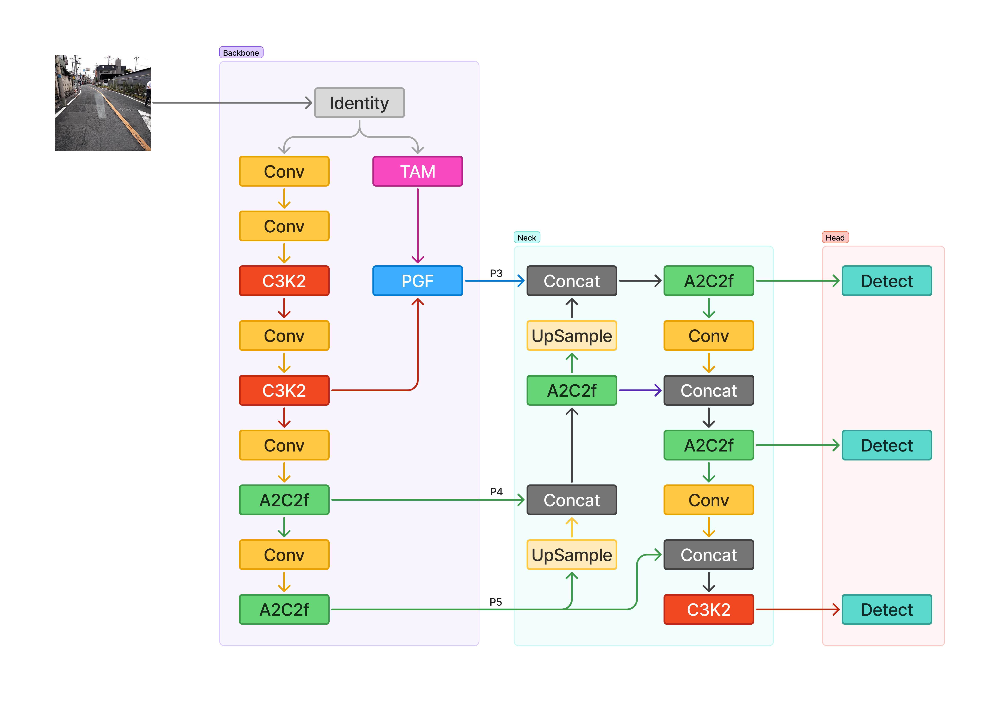

# Prior-Guided Feature Fusion for Crack Detection

**Domain-Informed Object Detection · PyTorch · Ultralytics YOLO**

Can we help an object detector learn what to look for by explicitly providing useful visual cues?

This project explores **prior-guided feature fusion**: incorporating handcrafted visual priors into YOLO-based object detectors and allowing the network to learn when those priors are useful.

The motivating application is road crack and pothole detection. Cracks can introduce abrupt local changes in road texture. Although a detector can learn such patterns from training data, learning them implicitly may be difficult when data is limited or when the visual signal is subtle. A handcrafted prior offers an additional source of information that the model can selectively exploit.

The central idea is simple: **provide the prior, but let the model learn whether to trust it.**

## The Approach

The method has two main components:

1. **Texture Anomaly Map:** Extracts local texture irregularities from an image to create a spatial prior.
2. **Prior Gated Fusion (PGF):** Integrates the prior into learned feature representations through a learnable, feature-dependent gate.

Rather than replacing the detector's learned features, the prior acts as an additional signal that can reinforce useful spatial information.

## 1. Texture Anomaly Map

A texture anomaly map highlights regions where local texture differs from its surrounding area.

For road surfaces, cracks may appear as narrow, irregular structures with different texture characteristics from the surrounding pavement. The proposed prior extractor uses handcrafted image processing to make these local variations more explicit.

  

### Pipeline

- **Grayscale conversion:** Converts the input image into a single intensity channel.
- **Gabor filter bank:** Applies oriented filters at \(\theta \in \{0,\pi/4,\pi/2,3\pi/4\}\) to capture directional texture responses.
- **Fine-texture energy:** Aggregates the absolute filter responses across orientations.
- **Multiscale smoothing:** Uses two average-pooling scales to estimate coarse texture variation.
- **High-frequency residual:** Subtracts the coarse estimates from the fine-texture response to emphasize local variations.
- **Edge suppression:** Uses Sobel gradient information to suppress responses associated with strong edges.
- **Normalization:** Produces the final texture anomaly map.

The resulting map serves as a handcrafted spatial prior. It does not directly predict cracks; instead, it provides a representation of texture irregularities that may help the detector localize relevant regions.

## 2. Prior Gated Fusion (PGF)

A handcrafted prior is not always correct. Texture changes can arise from road markings, shadows, surface repairs, or other structures unrelated to cracks.

Simply adding the prior to the feature map could therefore introduce misleading information.

**PGF addresses this by learning a gate that controls how much of the prior is incorporated into the feature representation.**

Let:

- ⨁ denote the backbone feature map.
- p denote the prior map.
- p̂ denote the projected prior.
- α denote the learned gate.

### Fusion mechanism

**1. Prior projection**

The prior is resized to match the spatial dimensions of the feature map and passed through a convolution, batch normalization, and ReLU projection.

$$
\hat{P} = \text{ReLU}(\text{BN}(\text{Conv}(\text{Resize}(P))))
$$

This transforms the prior into a feature representation compatible with the detector.

**2. Feature-dependent gate**

The feature map passes through adaptive average pooling, a convolution, and sigmoid activation.

$$
\alpha = \sigma(\text{Conv}(\text{AdaptiveAvgPool}(X)))
$$

The gate learns how strongly the projected prior should influence the feature representation.

**3. Gated residual fusion**

The projected prior is modulated by the gate and added to the original feature map.

$$
Y = X + \alpha \odot \hat{P}
$$

Here, $\odot$ denotes element-wise multiplication, with broadcasting where required by the implementation.

This residual formulation preserves the original feature representation while allowing the model to incorporate prior information when useful.

## 3. Detector Variants

The approach is explored through different YOLO architectures and prior-generation methods.

### YOLOv8 with Scribble-Derived Prior

This variant uses a custom `ScribbleMap` module to derive a prior from the input image. PGF modules are inserted at the P3 and P4 backbone feature stages, allowing prior-guided information to enter the detector at multiple resolutions.

The modified backbone feeds a feature-pyramid neck and three detection heads operating at P3, P4, and P5.

### YOLOv12 with Texture Anomaly Prior

This variant extends the approach to a YOLOv12-style architecture. The `TextureAnomalyMap` module generates the prior, which is fused with the P3 backbone features through PGF before entering the detection neck.

These variants explore two dimensions of the design: the type of prior supplied to the detector and the location at which prior-guided fusion is applied.

## 4. Motivation and Trade-offs

### Why introduce an explicit prior?

A conventional detector must learn relevant visual patterns from its training data. When a task has a useful, known visual characteristic, a handcrafted prior can expose that information directly to the network.

Potential benefits include:

- Making task-relevant visual cues more explicit.
- Providing additional spatial information when training data is limited.
- Allowing the detector to combine domain knowledge with learned representations.
- Learning to modulate the prior rather than relying on it unconditionally.

These are motivations for the approach, not guarantees of improved performance. Their value depends on the dataset, the prior's quality, and the detector architecture.

### What are the trade-offs?

The additional modules introduce parameters and computation. The handcrafted prior also requires preprocessing, which may contribute inference latency depending on its implementation.

A misleading or unnecessary prior can interfere with useful learned features, potentially making optimization more difficult or slowing convergence. The gate provides a mechanism for controlling this influence, but it does not guarantee that the model will ignore every harmful prior.

The relevant question is therefore not simply whether a prior contains useful information, but whether its benefits outweigh the additional complexity and computational cost.

## 5. Implementation

The custom modules are implemented as extensions to the [Ultralytics YOLO framework](https://github.com/Rahul-Samedavar/ultralytics).

The repository contains the framework modifications and custom module implementations, while the model configurations specify how the priors and fusion modules are integrated into the detector.

Key components include:

- `TextureAnomalyMap` — handcrafted texture-prior extraction.
- `ScribbleMap` — alternative prior-generation module.
- `PGF` — learnable prior-guided feature fusion.
- New Module Integration - extended model parsing and forward pass logic to support these new modules.
- Custom YOLO configurations — integration of the modules into different detector variants.

## 6. Artifacts

- **Framework and custom modules:** [Ultralytics fork](https://github.com/Rahul-Samedavar/ultralytics)
- **Architecture diagrams:** Available in this documentation's `images/` directory.
- **Model configurations:** Available in this documentation's `config/` directory and `ultralytics/cfg/models/pgf/` directory.
---

This project explores a broader idea: when a task has useful domain-specific structure, a model need not discover every relevant cue from data alone. We can expose that structure explicitly and learn how it should interact with the model's own representations.
